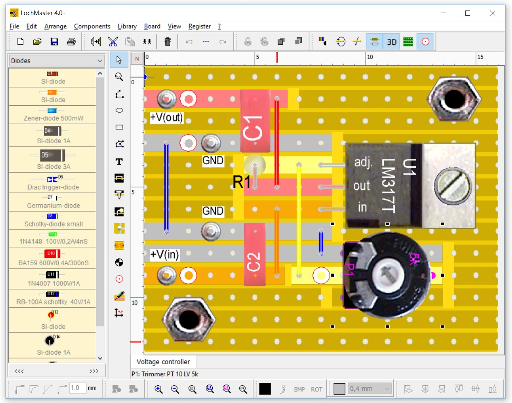
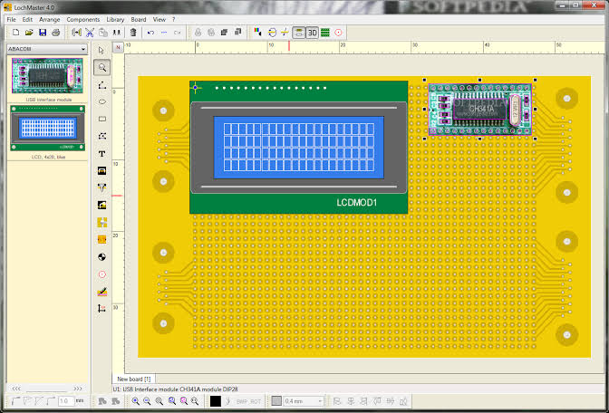
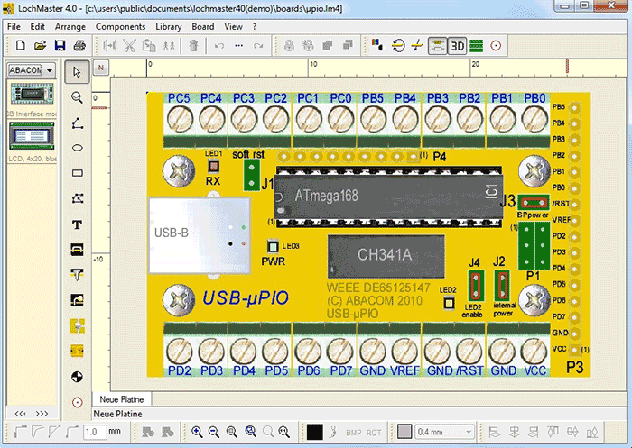

# LochMaster Stripboard Layouts From Grid to Assembly

A track cut drawn on the wrong side of a board can turn a correct circuit into a difficult repair.
ABACOM LochMaster helps plan component placement, copper interruptions, wire links, and assembly documentation before the first joint is soldered.

[](https://abacom-lochmaster.github.io/lochmaster/)

## Establish which side of the board you are reading

Choose the board type, hole grid, and copper direction before placing components.
Stripboard provides continuous copper strips; isolated-pad perfboard needs connections to be formed separately.

Mark a reference corner that remains recognisable when the board is turned over.
Keep component-side placement and solder-side cutting instructions clearly labelled.

For a separate coordinate worksheet, this example mirrors one-based hole columns across the vertical centreline.
It assumes cuts indexed at hole centres and leaves row numbers unchanged:

```python
columns, rows = 24, 12
component_side_cuts = [(7, 3), (14, 8)]

for column, row in component_side_cuts:
    if not (1 <= column <= columns and 1 <= row <= rows):
        raise ValueError("Cut lies outside the board grid.")
    solder_column = columns + 1 - column
    print(f"Component ({column}, {row}) -> solder ({solder_column}, {row})")
```

The transformation depends on the chosen flip direction and origin.
Compare the worksheet against the actual mirrored view before using it as a cutting reference.

In the companion materials, [sketch.pri](pri/sketch.pri) lists drawing-view sources.
[items.pri](pri/items.pri) lists graphical items including breadboards, wires, and holes.

## Fit the physical components before shortening the wiring

Start with connectors, sockets, controls, and mounting hardware that constrain the available space.
Then place the smaller components around the electrical connections.

LochMaster includes a component library and editing tools for custom parts.
Match the representation to the actual lead spacing, body size, and orientation of the purchased component.

| Physical feature | Component-side inspection | Solder-side inspection |
|---|---|---|
| IC or socket | Pin-one marker and body clearance | Pads and required copper interruptions |
| Polarised component | Polarity marking remains visible | Leads reach the intended strips |
| Connector | Mating direction and cable access | Terminal order matches the wiring plan |
| Mounting hole | Hardware clears component bodies | Copper clearance suits the chosen hardware |
| Wire link | Route avoids obstructing components | Both endpoints land on the intended conductors |

A compact layout still needs enough room to identify parts and reach solder joints.
Do not trade readable assembly instructions for a small reduction in board area.



The companion [model.pri](pri/model.pri) lists part and sketch model sources.
[referencemodel.pri](pri/referencemodel.pri) lists reference-library sources, while [partsbinpalette.pri](pri/partsbinpalette.pri) lists component-bin interfaces.

For a comparison of part-editing concepts, [parts_editor_help.html](help/parts_editor_help.html) describes Fritzing's historical editor workflow.
[partseditor.pri](pri/partseditor.pri) contains commented references to older editor sources.

## Treat copper cuts and wire links as one connection plan

A component can appear correctly positioned while its leads remain joined by an unwanted copper strip.
Review the copper underneath each device and between adjacent circuit sections.

For every intended connection, identify:

- The terminals that must share a conductor.
- The continuous copper that already provides that path.
- The cuts needed to separate neighbouring connections.
- The wire links needed to join otherwise isolated sections.
- The board side on which each operation is performed.

Place cuts where they remain easy to locate on the assembly print.
After moving a component, inspect its surrounding cuts and links again.

[connectors.pri](pri/connectors.pri) lists connector and bus-related sources in the companion project.
[infoview.pri](pri/infoview.pri) lists its information-view sources.

Route links so that their endpoints are unambiguous.
A line crossing another line in a drawing should not be mistaken for a soldered junction.

The companion [autoroute.pri](pri/autoroute.pri) lists routing and checking sources.
It is useful for locating those topics in a separate layout application.



## Follow each connection through Test mode

Use LochMaster's connection-checking mode to inspect the areas directly connected to a selected point.
Compare the highlighted copper and links with the intended circuit connections.

Review one connection group at a time:

1. Select a known terminal.
2. Follow the connected tracks and links.
3. Confirm that all intended endpoints are included.
4. Look for neighbouring terminals that should remain separate.
5. Repeat after changing any cut, link, or component position.

Keep a short list of expected endpoint groups beside the layout.
That list makes the check repeatable when the physical arrangement changes.

Connectivity checking establishes which conductors are joined.
Circuit behaviour also depends on component values, pin functions, and the circuit design.

For a distinct circuit-simulation reference, [test_ngspice_simulator.cpp](tests/auto/test_ngspice_simulator/test_ngspice_simulator.cpp) exercises a separate ngspice interface.
Use that example to distinguish numerical circuit simulation from inspecting direct board connections.

## Turn the parts list into an assembly aid

Use the same reference designators on the layout, parts list, and any supporting circuit drawing.
A value alone may not identify the correct component when package size or lead spacing differs.

LochMaster can generate component lists for documentation.
Before summarising a list in another tool, normalise its columns and check that each row represents one component.

This Python example expects a prepared UTF-8 CSV with Ref, Value, and Footprint columns:

```python
import csv
from collections import Counter

with open("parts.csv", newline="", encoding="utf-8-sig") as source:
    parts = list(csv.DictReader(source))
counts = Counter((part["Value"].strip(), part["Footprint"].strip()) for part in parts)
for (value, footprint), quantity in sorted(counts.items()):
    print(f"{quantity:>3}  {value:<16}  {footprint}")
```

Keep the original reference-level list as well as the grouped purchasing totals.
The prepared CSV is a worksheet format for this example, rather than an assumed LochMaster export schema.

Record which layout revision produced the list.
The companion [test_project_properties.cpp](tests/auto/test_project_properties/test_project_properties.cpp) covers loading project properties from XML.

## Print a view that can be used at the bench

Prepare separate component-placement and copper-cutting views when that makes the construction sequence clearer.
Include the board reference corner, orientation, and revision on each sheet.

Check the physical print scale against a known distance on the actual board.
Printer scaling can make a correctly dimensioned drawing unsuitable as a positioning guide.

Use enough contrast to distinguish:

- Component outlines from wire links.
- Copper strips from interrupted sections.
- Reference designators from component values.
- Mounting holes from electrical connections.



The companion [svg.pri](pri/svg.pri) lists graphics, conversion, and document-generation sources.
Its graphics-related tests cover several separate concerns:

- [test_svgtext.cpp](tests/auto/test_svg/test_svgtext.cpp): SVG text bounds.
- [test_pathparse.cpp](tests/auto/test_svg/test_pathparse.cpp): SVG path parsing.
- [test_pathlexer_public.cpp](tests/auto/test_svg/test_pathlexer_public.cpp): SVG path token processing.
- [test_svg2gerber.cpp](tests/auto/test_svg2gerber/test_svg2gerber.cpp): whitespace handling during a conversion operation.
- [test_textutils.cpp](tests/auto/test_textutils/test_textutils.cpp): text utilities including font-name handling.

These references provide examples of graphics-processing concerns when reviewing an exported drawing.
Inspect the actual LochMaster print for legible labels and correctly located cuts.

## Keep the build record tied to the saved layout

Before assembly, save the layout and its associated parts list and printouts under an identifiable revision.
Record any substitutions or physical changes made while constructing the board.

A useful build record includes:

- Board dimensions and grid convention.
- Component-side and solder-side orientation.
- The final cut and link plan.
- Component substitutions and pinout checks.
- The parts list used for assembly.
- Any changes discovered during continuity inspection.

The companion [test_folderutils.cpp](tests/auto/test_folderutils/test_folderutils.cpp) checks sanitising identifiers for filesystem paths.
[eagle.pri](pri/eagle.pri) lists a Fritzing-to-EAGLE conversion source as an example of a separate interchange component.

Do not assume that a drawing imported or recreated in another tool preserves its electrical meaning automatically.
Compare terminal identities, copper interruptions, and board orientation after any transfer.

## Related Search Terms

abacom lochmaster, lochmaster, lochmaster 4.0, lochmaster software, lochmaster stripboard designer, electronics, eda, cad, schematic, pcb, stripboard, perfboard, circuit-layout, prototyping, fritzing-application
